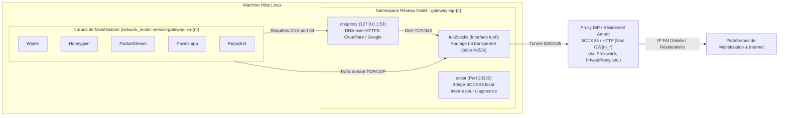

# Guide d'Intégration & Exploitation : Passerelle Dédiée Static ISP / Residential

Ce document décrit l'architecture déployée et la procédure d'exploitation pour les **Passerelles Proxies Dédiées Static ISP / Residential** (jusqu'à 4 passerelles parallèles `gateway-isp-1..4`) à **bande passante illimitée**, garantissant l'isolation totale et la protection de l'adresse IP de votre domicile ou de la machine hôte.

---

## 1. Architecture Technique Réalisée

Chaque conteneur passerelle **`gateway-isp-{n}`** assure l'interception transparente du trafic réseau L3/L4 pour le pool de conteneurs de monétisation qui lui est rattaché (*Wipter, Honeygain, PacketStream, Pawns.app, Repocket* via `network_mode: service:gateway-isp-{n}`).



### Caractéristiques Clés :
1. **Transparence L3 Intégrale :** Aucun paramétrage de proxy interne n'est requis dans les applications de monétisation.
2. **Résolveur DNS-over-HTTPS (DoH) Intégré :** Les proxys SOCKS5 ne gèrent pas toujours le trafic UDP brut. Le composant `dnsproxy` écoute localement sur `127.0.0.1:53` dans chaque passerelle et achemine les résolutions DNS via HTTPS (`1.1.1.1` et `8.8.8.8`) à travers le proxy.
3. **Zéro Fuite d'IP Locale (Kill-Switch) :** En cas d'interruption du proxy distant, le trafic du pool concerné est bloqué au niveau L3 et ne retombe jamais sur votre connexion personnelle ou l'IP de la VM hôte.
4. **Bridge Local de Diagnostic (interne) :** Chaque conteneur `gateway-isp-{n}` expose un pont SOCKS5 sur `127.0.0.1:23320` (loopback du conteneur uniquement, aucun port exposé sur l'hôte). Les tests s'effectuent via le dashboard Web ou avec `./scripts/test_proxy.sh [HOST:PORT] [socks5|http] [gateway]`.

---

## 2. Commandes d'Exploitation Rapide

### 1. Démarrer la Stack Multi-Passerelles
```bash
./scripts/start.sh
```

### 2. Configurer ou Changer de Proxy Manuellement
Pour basculer le proxy amont d'une passerelle cible (argument `[gateway]`, défaut `1`) :
```bash
# Passerelle 1 (défaut) :
./scripts/switch_isp_proxy.sh proxy1.example.com:1080 socks5 1

# Passerelle 2 avec authentification :
./scripts/switch_isp_proxy.sh proxy2.example.com:1080:utilisateur:motdepasse socks5 2
```

### 3. Vérifier l'État Complet & Diagnostics
Affiche les conteneurs actifs, l'IP publique active de chaque passerelle, et la résolution DNS :
```bash
./scripts/status.sh
```

### 4. Tester la Connectivité SOCKS5 depuis l'Hôte
Teste la connectivité via le pont local interne de la passerelle spécifiée (défaut 1) :
```bash
./scripts/test_proxy.sh gateway-isp-1 23320 socks5
# ou simplement :
./scripts/test_proxy.sh
```

---

## 3. Configuration des Variables (`.env`)

L'architecture supporte jusqu'à 4 passerelles avec des blocs `GW{n}_*`. Les clés historiques mono-passerelle (`ISP_PROXY_*`) restent acceptées en fallback transparent pour la passerelle 1.

```ini
# ==============================================================================
# Configuration Multi-Passerelles ISP
# ==============================================================================
ENABLED_GATEWAYS="1"
COMPOSE_PROFILES="repocket"

# Passerelle 1 (ou variables globales historiques ISP_PROXY_*)
GW1_ISP_PROXY_PROTOCOL="socks5"
GW1_ISP_PROXY_HOST="proxy1.example.com"
GW1_ISP_PROXY_PORT="1080"
GW1_ISP_PROXY_USER=""
GW1_ISP_PROXY_PASS=""
GW1_HOSTNAME="DESKTOP-D8F2A14"

# Passerelle 2 (si ENABLED_GATEWAYS="1,2")
GW2_ISP_PROXY_PROTOCOL="socks5"
GW2_ISP_PROXY_HOST="proxy2.example.com"
GW2_ISP_PROXY_PORT="1080"
GW2_ISP_PROXY_USER=""
GW2_ISP_PROXY_PASS=""
GW2_HOSTNAME="DESKTOP-K4M9B27"

GATEWAY_LOGLEVEL="warn"
```

> ⚠️ **Note sur Pawns.app** : Pawns.app rejette les proxys ISP commerciaux Proxiware (`non_residential_ip`) et boucle en crash exit 1. Il est recommandé de le retirer de `COMPOSE_PROFILES` sur ces proxys.

---

## 4. Résultats des Tests de Validation en Direct (Historique Initial Passerelle 1)

| Service | Statut de Connexion | IP Validée | Notes |
| :--- | :--- | :--- | :--- |
| **Passerelle `gateway-isp-1`** | [✓] Healthy | `194.70.234.223` (Paris, FR) | Latence ~240 ms, DoH Cloudflare opérationnel |
| **Repocket** | [✓] Actif & Connecté | `194.70.234.223` (Paris, FR) | Authentification 200 OK, `markPeerAsAlive` |
| **Bridge Local (interne 127.0.0.1:23320)** | [✓] Opérationnel | `194.70.234.223` (Paris, FR) | Test curl réussi via `./scripts/test_proxy.sh` |
